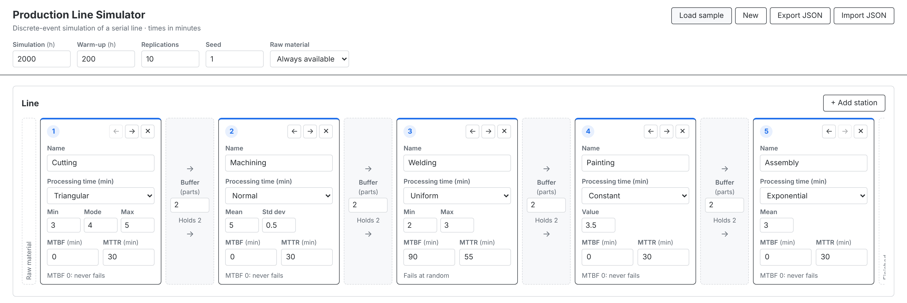
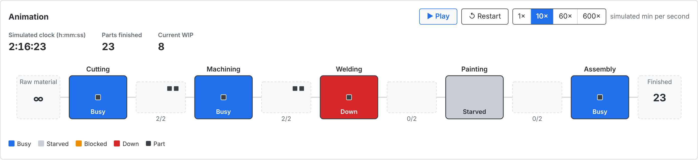
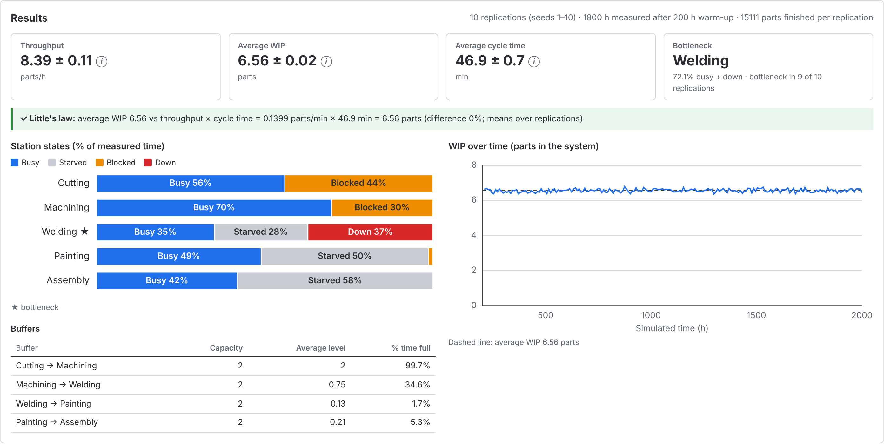
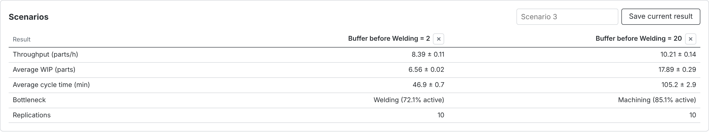

# Production Line Simulator

**[Live demo](https://line-simulatorv1.vercel.app)**

A discrete-event simulation (DES) of a serial production line, running in the browser. It models variable processing times, finite buffers, blocking and random machine breakdowns. You can watch the line run in an animated view driven by the simulation engine itself, and get results with 95% confidence intervals from independent replications.

The simulation engine is written from scratch in plain JavaScript and validated against queueing theory (M/M/1, Little's law, availability, a two-station blocking model). It is the fourth tool in a series on production engineering, moving from formulas to simulation.



## Features

- **Line editor**: stations from left to right, each with a name, processing-time distribution (constant, uniform, triangular, normal, exponential), MTBF and MTTR, and a buffer of any capacity (0 = no buffer) between each pair. You can add, delete and reorder stations.
- **Input validation**: invalid input gets a red border and a message, and reverts to the last valid value when you leave the field. A comma is accepted as decimal separator.
- **Raw material**: either always available, or arriving with a random interarrival time. An orange notice warns when arrivals reach or exceed the capacity of the slowest station.
- **Simulation in a Web Worker** with a progress bar, so the page never freezes.
- **Replications**: seeds `seed, seed + 1, …`; throughput, WIP and cycle time are shown as mean ± 95% confidence interval (Student t).
- **Results**:
  - throughput, average WIP, average cycle time and the bottleneck
  - a Little's law check (WIP vs throughput × cycle time)
  - a station state chart (busy / starved / blocked / down) and a buffer table (average level, % time full)
  - WIP over time
- **Animation**: stations are coloured and labelled by their current state, buffers show waiting parts as squares, and parts move through the line. Play, pause and restart, speeds of 1×, 10×, 60× and 600× (simulated minutes per real second), a simulated clock and counters for parts finished and current WIP.
- **Scenarios**: save up to 4 named results and compare them side by side for what-if analysis.
- **Saving**: the model and scenarios auto-save to `localStorage`. You can load a sample model, start a new one, export to JSON, and import from JSON (with validation and a confirmation step).

| Animation | Results |
| --- | --- |
|  |  |

## How the engine works

The engine lives in `src/sim` as pure modules without React, and every part has tests.

| Module | Role |
| --- | --- |
| `eventQueue.js` | Binary min-heap ordered by event time; a sequence number breaks ties first-in first-out, so runs are fully deterministic. |
| `random.js` | Seeded random numbers and sampling for the five distributions. |
| `engine.js` | Generic clock and event loop: schedule, cancel (lazy deletion), step, run until a time. |
| `line.js` | The serial line model built on the engine. |
| `lineStatistics.js`, `statistics.js` | Time-weighted statistics, station state timers and the bottleneck. |
| `lineSnapshot.js` | Read-only view of the line state for the animation. |
| `replications.js`, `confidence.js` | Replications and Student t confidence intervals. |
| `capacity.js` | Static capacity check (arrival rate vs slowest station). |

### Event types

| Event | What happens |
| --- | --- |
| `arrival` | A part arrives in the input queue in front of station 1 (interarrival source only). |
| `finish` | A station completes its part; the part then moves downstream or the station becomes blocked. |
| `fail` | A station breaks down. A part in process is paused and its remaining time stored. |
| `repair` | The repair is complete; a paused part resumes with its remaining time and the next failure is scheduled. |
| `sample` | One point of the WIP-over-time series is recorded. |

After every event, all moves that are possible at that instant (part to buffer, buffer to station, station to station) are applied until nothing more can move. The statistics are then updated.

### Blocking rule

The line uses **blocking after service**. When a station finishes a part and the downstream buffer is full, the part stays on the station and the station is *blocked* until space frees up. With a buffer capacity of 0, the part moves straight to the next station, which must be free: not busy, not blocked and not down. A station that is down neither accepts nor releases parts.

Every station is always in exactly one state: **busy**, **starved** (waiting for a part), **blocked** or **down**.

### Breakdown model

Failures are **time-based**. Time to failure is exponential with mean MTBF, repair time is exponential with mean MTTR, and the failure clock runs in every state. A breakdown during processing pauses the part, and processing resumes after the repair with the remaining time, so no work is lost. MTBF = 0 means the station never fails. Long-run availability is MTBF ÷ (MTBF + MTTR).

### Warm-up and measurement

The simulation hours include the warm-up. All statistics are reset after the last event at the warm-up time, so the measurement period is (warm-up, end]: a part leaving exactly at the warm-up time is not counted, one leaving exactly at the end is. Cycle time runs from a part's arrival in the system to its exit from the last station, and WIP counts every part in that span, including the input queue. Each point on the WIP-over-time chart is the time-average over its sampling interval (200 intervals after the warm-up).

### Bottleneck

The bottleneck is found with the **active period** approach (Roser, Nakano and Tanaka, 2001). A station is *active* while it is busy or down, because then it is the one holding up the flow; while starved or blocked it is waiting for another station. The station with the highest % busy + % down is the bottleneck. Unlike plain utilisation, this also catches an unreliable machine whose busy time alone looks moderate.

Ties are broken by the highest mean effective processing time, mean processing time ÷ availability. A tie happens, for example, with unlimited raw material and buffers that never fill: station 1 is then never starved or blocked and is 100% active, just like the true bottleneck. Across replications, the bottleneck is taken from the mean station states, and the app shows how many replications agree.

### Random numbers and replications

Each replication uses one seeded stream. Replication *r* uses seed `seed + r`, so results are exactly reproducible.

The generator is **xoshiro128\*\*** (Blackman and Vigna), with a period of 2¹²⁸ − 1. **Mulberry32** is used only to expand the 32-bit seed into its 128-bit state. Mulberry32 alone would be a poor choice here: it is a counter-based generator with a single cycle of 2³², and consecutive seeds start at fixed offsets on that cycle. For some r ≤ 1000, the streams of `seed` and `seed + r` start only **680,841 draws apart**, while one long replication can use millions of draws, so two replications would reuse the same random numbers. Hashing the seed doesn't fix this, because with only 2³² positions overlaps between ~30 replications of a few million draws become likely (the birthday problem). A 2¹²⁸ period makes overlaps practically impossible.

Confidence intervals use the replication means: mean ± t(0.975, n − 1) · s ÷ √n. Values of t come from a table up to 30 degrees of freedom, and above that from a Cornish–Fisher expansion (error < 0.001).

## Validation

These tests are the most important ones in the project (`tests/sim/validation.test.js`, `replications.test.js`, `random.test.js`). All values below come from the test runs with their fixed seeds. The suite has 98 tests in total.

| Test | Theory | Simulated | Tolerance |
| --- | --- | --- | --- |
| Deterministic line 5 / 8 / 6 min, no failures, large buffers: throughput | 60 ÷ 8 = **7.5** parts/h | **7.5** (exact) | exact |
| Same, bottleneck (stations 1 and 2 tie at 100% active; tie rule) | Station 2 | Station 2 | exact |
| Deterministic 5 / 8 min with zero buffer: station 1 blocked | 3 ÷ 8 = **37.5%** | **37.5%** | exact |
| M/M/1, λ = 1/10, μ = 1/8 (ρ = 0.8), one run of 300,761 parts: number in system L | ρ ÷ (1 − ρ) = **4** | **4.088** | ± 5% |
| M/M/1: time in system W | 1 ÷ (μ − λ) = **40 min** | **40.77 min** | ± 5% |
| M/M/1: utilisation | **80%** | **80.19%** | ± 1 pp |
| M/M/1: throughput | **6** parts/h | **6.015** | ± 1% |
| M/M/1, 10 replications: 95% CI for W | contains 40 | **39.60 ± 1.49** ✓ | must contain |
| M/M/1, 10 replications: 95% CI for L | contains 4 | **3.961 ± 0.159** ✓ | must contain |
| Little's law on a 4-station line with failures and finite buffers: L vs λ·W | equal | **6.1822** vs **6.1820** | ± 1% |
| Single station, MTBF 100, MTTR 10, never starved: availability | 100 ÷ 110 = **0.9091** | **0.9087** | ± 0.005 |
| Same, throughput with resumed work | 12 × 0.9091 = **10.909** parts/h | **10.904** | ± 1% |
| Two identical exponential stations (mean 10 min), zero buffer: throughput | ⅔ μ = **4.0** parts/h | **3.997** | ± 2% |
| Same, station 1 blocked / station 2 starved | **33.3%** / **33.3%** | **33.36%** / **33.30%** | ± 1 pp |
| **CI coverage**, normal data, 4,000 intervals of n = 5 | **95%** | **95.2%** | ± 1.2 pp |
| CI coverage, skewed exponential data, 2,000 intervals of n = 5 | slightly below 95% | **89.4%** | 85–97% |
| Student t(0.975) for df = 1 / 9 / 40 / 99 | 12.706 / 2.262 / 2.021 / 1.984 | 12.706 / 2.262 / 2.0211 / 1.9842 | ± 0.001 |
| Distributions, 100,000 samples each: mean and variance | theory (incl. truncated normal) | all within tolerance | 4 standard errors / 3% |
| State percentages per station | sum to **100%** | 100% | 10⁻⁹ |
| Same seed twice | identical results | identical | exact |
| Animation stepping (many small steps, or one event at a time) | same results as one run | identical | exact |

The M/M/1 values from a single run are about 2% above theory, which is within the normal sampling error of one run at ρ = 0.8. The replication intervals contain the theoretical values. The two coverage rows check the intervals themselves. With normal data the coverage matches the nominal 95%. With skewed data and only 5 values it falls a little short, which is the known behaviour of t intervals. Replication means over long runs are close to normal, so the intervals in the app sit near the first case.

## What-if example: one bigger buffer moves the bottleneck

The sample line (**Load sample**) has five stations with mixed distributions and buffers of 2. Welding is fast (2–3 min) but unreliable: MTBF 90 min, MTTR 55 min, availability 62%. Raising only the buffer **Machining → Welding** from 2 to 20 gives (10 replications each):

| Buffer before Welding | Throughput (parts/h) | Average WIP (parts) | Average cycle time (min) | Bottleneck |
| --- | --- | --- | --- | --- |
| 2 | 8.39 ± 0.11 | 6.56 ± 0.02 | 46.9 ± 0.7 | Welding (72.1% active, 9 of 10 replications) |
| 20 | 10.21 ± 0.14 | 17.89 ± 0.29 | 105.2 ± 2.9 | Machining (85.1% active, 10 of 10 replications) |

**Finding:** the bigger buffer raises throughput by **22%** (+1.8 parts/h) and moves the bottleneck from Welding to Machining, but WIP rises **2.7×** (6.6 → 17.9 parts) and cycle time **2.2×** (47 → 105 min).

**Trade-off:** the buffer lets Machining keep working while Welding is under repair, so the line loses fewer parts to breakdowns. But the same buffer is full of parts waiting most of the time, so each part takes longer to get through. More output is bought with more inventory and a longer lead time, and the root cause (long Welding repairs) is still there.



These numbers are checked by `tests/sim/sampleModel.test.js`. I also checked the bottleneck shift with other seed ranges (seeds 1, 101 and 1001, 20 replications each): Welding is the bottleneck in 19–20 of 20 replications with buffer 2, and Machining in 20 of 20 with buffer 20.

## Assumptions and limitations

- **Serial line only.** Each station processes one part at a time, with FIFO buffers and blocking after service. There are no parallel machines, rework, scrap, setups, batches or shifts.
- **Time units.** All times are in minutes.
- **Normal distribution.** It is truncated at 0 by rejection sampling: negative draws are redrawn. When the mean is small relative to the standard deviation, the actual mean is higher than the mean you enter (the effective-capacity calculations use the truncated mean). Every distribution must have a mean above 0.
- **Failures.**
  - Failures are time-based: they also happen while a station is starved or blocked.
  - Times to failure and repair times are exponential.
  - Work is never lost when a failure interrupts a part.
- **Warm-up.** You choose the warm-up length; the app does not detect a steady state. The WIP chart helps you judge whether the warm-up was long enough.
- **Unstable lines.** If arrivals exceed capacity, the line has no steady state. The app warns you, and the results then depend on the run length.
- **Capacity check.** The warning compares the arrival rate with 60 ÷ (mean processing time ÷ availability) of the slowest station. With variability and finite buffers, the real capacity is lower, so a line can also be unstable slightly below this limit.
- **Little's law check.** Over replications it compares the mean WIP with the product of the mean throughput and the mean cycle time. That is an approximation, but a close one for long runs.
- **Animation.** It shows the same engine from time 0, warm-up included. At high speeds, parts jump instead of gliding, so the view always matches the engine's state.
- **Limits.** At most 10 stations, buffers up to 10,000 parts, runs up to 100,000 hours and up to 100 replications.

## Run locally

Requires Node.js 20.19+ or 22.12+ (as required by Vite 8).

```bash
git clone https://github.com/CharilaosStavrou/line-simulatorv1.git
cd line-simulatorv1
npm install
npm run dev        # development server at http://localhost:5173
npm test           # Vitest unit and validation tests
npm run lint       # ESLint
npm run build      # production build in dist/
```

## Deploy

The repository includes a `vercel.json` for a Vite build (`npm run build`, output `dist`).

1. Push the repository to GitHub.
2. In Vercel, choose **Add New → Project**, import the repository and keep the detected settings.
3. Deploy. Every push to `main` then deploys automatically.

Or from the command line: `npx vercel` (preview) and `npx vercel --prod`.

## Tech stack

- React 19 and Vite, in plain JavaScript
- Plain CSS: one global stylesheet with CSS variables
- Charts and animation in plain SVG, with no chart or animation library
- A simulation engine written from scratch, with no simulation library, running in a Web Worker
- Vitest for tests and ESLint for linting
- Vercel for hosting

## Related projects

- [Value Stream Mapping tool](https://github.com/CharilaosStavrou/vsm-tool): map a value stream and its lead time.
- [Kanban / Supermarket Calculator](https://github.com/CharilaosStavrou/kanban-calculator): size kanban loops and supermarkets.
- [Aggregate Planning tool](https://github.com/CharilaosStavrou/aggregate-planning): production planning with linear programming.

## Future improvements

- Parallel machines at a station
- Rework loops and scrap
- Shift calendars and planned downtime
- Operation-dependent failures: failures only while a station is busy
- Importing a line from the VSM tool

## License

[MIT](LICENSE) © 2026 Charilaos Stavrou
